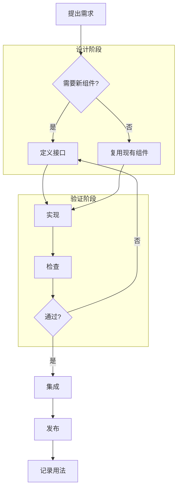

## 色彩

500 档保留 `#00ABD6` 和 `#FF9A57`。橙色按明度插值，OKLCH 色相从 62° 逐档降至 38°，由橙黄过渡到橙红。HEX 是 sRGB 近似值，HSB 仅用于标注，不参与推导。

### 青 · OKLCH 224

<div class="ramp not-prose">
  <div class="ramp-chip" style="background: var(--color-cyan-50)">50</div>
  <div class="ramp-chip" style="background: var(--color-cyan-100)">100</div>
  <div class="ramp-chip" style="background: var(--color-cyan-300)">300</div>
  <div class="ramp-chip ramp-chip-inverse" style="background: var(--color-cyan-500)">500</div>
  <div class="ramp-chip ramp-chip-inverse" style="background: var(--color-cyan-700)">700</div>
  <div class="ramp-chip ramp-chip-inverse" style="background: var(--color-cyan-900)">900</div>
</div>

| 档位 | HEX 近似值 | HSB | OKLCH |
| --- | --- | --- | --- |
| 50 | `#e8f8ff` | 198 / 9 / 100 | 0.970 / 0.019 / 224 |
| 100 | `#c9efff` | 198 / 21 / 100 | 0.930 / 0.045 / 224 |
| 300 | `#80dcfe` | 196 / 50 / 100 | 0.850 / 0.100 / 224 |
| 500 | `#00abd6` | 192 / 100 / 84 | 0.689 / 0.129 / 224 |
| 700 | `#0f7d9d` | 194 / 90 / 62 | 0.550 / 0.100 / 224 |
| 900 | `#034a5e` | 193 / 97 / 37 | 0.380 / 0.070 / 224 |

### 橙色

<div class="ramp not-prose">
  <div class="ramp-chip" style="background: var(--color-orange-50)">50</div>
  <div class="ramp-chip" style="background: var(--color-orange-100)">100</div>
  <div class="ramp-chip" style="background: var(--color-orange-300)">300</div>
  <div class="ramp-chip ramp-chip-inverse" style="background: var(--color-orange-500)">500</div>
  <div class="ramp-chip ramp-chip-inverse" style="background: var(--color-orange-700)">700</div>
  <div class="ramp-chip ramp-chip-inverse" style="background: var(--color-orange-900)">900</div>
</div>

| 档位 | HEX 近似值 | HSB | OKLCH |
| --- | --- | --- | --- |
| 50 | `#fdf3ea` | 28 / 8 / 99 | 0.970 / 0.016 / 62 |
| 100 | `#fde2ce` | 26 / 19 / 99 | 0.930 / 0.040 / 59 |
| 300 | `#fcbf94` | 25 / 41 / 99 | 0.850 / 0.090 / 56 |
| 500 | `#ff9a57` | 24 / 66 / 100 | 0.779 / 0.146 / 52 |
| 700 | `#bc4602` | 22 / 99 / 74 | 0.551 / 0.165 / 42 |
| 900 | `#742304` | 17 / 97 / 46 | 0.380 / 0.120 / 38 |

HSB 依次表示色相、饱和度、明度；OKLCH 依次表示感知亮度、彩度、感知色相。

- `--color-surface`：页面。
- `--color-surface-raised`：卡片和控件。
- `--color-text`、`--color-text-muted`：正文和辅助文字。
- `--color-border`：边线。

## 文字

<div class="demo-stack">
  <div class="demo-serif">宋体：阅读与叙述。</div>
  <div class="demo-sans">无衬线：按钮与控件。</div>
  <div class="demo-mono">等宽：代码与数据。</div>
</div>

<p class="demo-lede">导语用较大的字号和较弱的文字颜色。</p>

<div class="not-prose">
  <div class="demo-h1">标题 1</div>
  <div class="demo-h2">标题 2</div>
  <div class="demo-h3">标题 3</div>
  <div class="demo-h4">标题 4</div>
  <div class="demo-h5">标题 5</div>
  <div class="demo-h6">标题 6</div>
</div>

正文用 500，标题和强调用 600–700。可以插入[链接](#文字)、**粗体**、*斜体*、`inline code` 和 <span class="kbd">⌘</span> <span class="kbd">K</span>。

## 列表

- 无序列表保持简单。
- 层级靠缩进，不靠装饰。
  - 嵌套项使用相同样式。
  - 内容过长时自然换行。

1. 有序列表用于步骤。
2. 每一步只讲一个动作。
3. 需要解释时放在步骤后面。

## 引用

> 用于引用原文或补充观点。
>
> 不写装饰性的空话。

## 代码

行内代码用于命令、字段和短标识。块级代码用于完整示例。

```ts
type Note = {
  title: string;
  tags: string[];
  publishedAt?: Date;
};

// 格式化标题、发布日期和标签。
export function formatNote(note: Note): string {
  const date = note.publishedAt?.toLocaleDateString("zh-CN", {
    year: "numeric",
    month: "long",
    day: "numeric",
  });
  const tags = note.tags.map((tag) => `#${tag}`).join(" ");

  if (!tags) return `${note.title} · ${date ?? "未发布"}`;

  return `${note.title} · ${date ?? "草稿"} · ${tags}`;
}

console.log(formatNote({ title: "设计系统", tags: ["design", "typescript"] }));
```

## 公式

行内公式：$a^2 + b^2 = c^2$。

块级公式：

$$
\operatorname{Attention}(Q, K, V)
= \operatorname{softmax}\left(\frac{QK^{\top}}{\sqrt{d_k}}\right)V
$$

## 图示

Mermaid 默认限高 36rem。图片和 Mermaid 支持点击放大，双指缩放、拖动查看，Esc 关闭。

### Mermaid



### 图片


## 表格

| 元素 | 用途 |
| --- | --- |
| 主色 | 链接、当前状态、主要操作 |
| 橙色 | 关键操作、重点提醒 |
| 中性色 | 正文、边线、背景 |

## 按钮

一页只设一个主按钮。橙色用于少量关键动作。

<div class="demo-row not-prose">
  <button class="btn">默认</button>
  <button class="btn btn-primary">主要操作</button>
  <button class="btn btn-accent">关键操作</button>
  <button class="btn btn-ghost">取消</button>
  <button class="btn" disabled>禁用</button>
</div>

```html
<button class="btn btn-primary">主要操作</button>
<button class="btn btn-ghost">取消</button>
```

## 徽标

只标状态，不做装饰。

<div class="demo-row not-prose">
  <span class="badge">草稿</span>
  <span class="badge badge-primary">当前</span>
  <span class="badge badge-accent">关注</span>
  <span class="badge badge-success">完成</span>
  <span class="badge badge-danger">失败</span>
</div>

```html
<span class="badge">草稿</span>
<span class="badge badge-primary">当前</span>
<span class="badge badge-accent">关注</span>
<span class="badge badge-success">完成</span>
<span class="badge badge-danger">失败</span>
```

## 高亮

能并入正文，就不用高亮。

<div class="highlight">
  <span class="highlight-icon" aria-hidden="true">💡</span>
  <div>
    <div class="highlight-title">说明</div>
    补充理解所需的背景。
  </div>
</div>

<div class="highlight highlight-accent">
  <span class="highlight-icon" aria-hidden="true">⚠️</span>
  <div>
    <div class="highlight-title">注意</div>
    只在需要提醒时使用。
  </div>
</div>

```html
<div class="highlight">
  <span class="highlight-icon" aria-hidden="true">💡</span>
  <div>
    <div class="highlight-title">说明</div>
    补充理解所需的背景。
  </div>
</div>
```

## 表单

使用原生控件。样式只统一边框、焦点和间距。

<div class="demo-stack not-prose">
  <label class="form-field">
    <span class="field-label">单行输入</span>
    <input class="field" type="text" placeholder="输入内容" />
  </label>
  <label class="form-field">
    <span class="field-label">多行输入</span>
    <textarea class="field" rows="3" placeholder="输入内容"></textarea>
  </label>
  <label class="form-field">
    <span class="field-label">下拉选择</span>
    <select class="field">
      <option>选项一</option>
      <option>选项二</option>
    </select>
  </label>
  <div class="demo-row">
    <label class="choice"><input type="radio" name="demo-choice" checked />单选一</label>
    <label class="choice"><input type="radio" name="demo-choice" />单选二</label>
  </div>
  <label class="choice"><input type="checkbox" checked />记住选择</label>
</div>

```html
<input class="field" type="text" placeholder="单行输入" />

<label class="choice">
  <input type="checkbox" checked />
  记住选择
</label>
```

## 折叠

使用原生 `<details>`，不需要脚本。

<details class="accordion">
  <summary>什么时候使用折叠？</summary>
  <div class="accordion-body">内容次要，但值得保留时。</div>
</details>

<details class="accordion">
  <summary>主要内容也折叠吗？</summary>
  <div class="accordion-body">主要内容直接放在正文里。</div>
</details>

```html
<details class="accordion">
  <summary>什么时候使用折叠？</summary>
  <div class="accordion-body">内容次要，但值得保留时。</div>
</details>
```

## 界面组件

### 时间

静态内容先显示，浏览器再按本地时区更新：

<time datetime="2026-01-01T00:00:00+08:00" data-local-time data-format="datetime">2026-01-01 08:00</time>

其他页面统一使用 `<Time date={date} />`，需要显示时分时加上 `format="datetime"`。

### 抽屉

<button id="drawer-demo-trigger" class="btn btn-primary" aria-controls="drawer-demo" aria-haspopup="dialog" aria-expanded="false">打开抽屉</button>

<dialog id="drawer-demo" class="demo-dialog" data-drawer data-side="right" aria-label="抽屉示例">
  <div class="demo-row" style="justify-content: space-between">
    <strong>抽屉</strong>
    <button class="btn" data-drawer-close>关闭</button>
  </div>
  <p>支持 Escape、遮罩关闭和焦点约束。</p>
  <a href="#界面组件">跳转并关闭</a>
</dialog>

实际开发统一使用 `<Drawer>`。本页左侧是 `<NoteTree>` 生成的目录，左上角可以切换主题。

## 维护

新组件先考虑 CSS 和原生元素，必要时再写脚本。修改组件时，同时检查深色模式、键盘和移动端。
